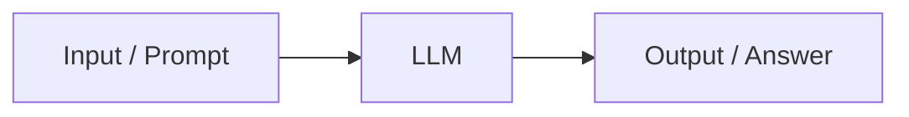
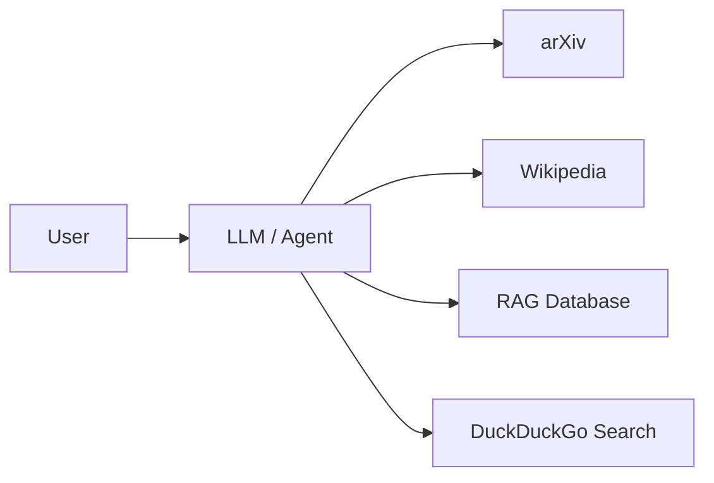

# Model Context Protocol (MCP)

> [!abstract] Main idea
> An **LLM** can generate an answer. **MCP** gives the application a standard way to connect that LLM to many external tools.

## 1. LLM without tools

A basic generative-AI flow is simple:

The LLM answers using its training and the context given in the prompt. It cannot directly get live or private information by itself.

## 2. LLM with tools

For an AI agent, the LLM may need external help:

These tools provide current data, search, documents, or actions.

## 3. Why MCP?

An LLM may need to use many tools. If every tool uses a different connection method, integration becomes difficult.

**MCP is the common protocol between the AI application and external tools.** It is like a USB-C standard: one common connection, many compatible services.

> [!important] Remember
> **LLM = thinks and generates**  
> **Tools = fetch data or perform actions**  
> **MCP = standard connection protocol**

## Key Takeaways

- MCP stands for **Model Context Protocol**.
- It is an open protocol introduced by Anthropic.
- It helps AI applications connect to tools and data in a standard way.
- MCP does not replace an LLM or an API; it connects them cleanly.

## Navigation

**Next:** [[02 - MCP Architecture]]
