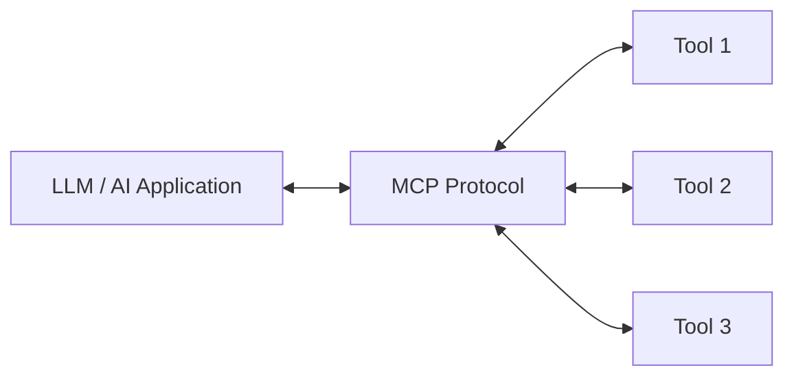

# MCP Architecture

> [!abstract] In one line
> MCP sits between an AI application and many external tools, giving them one common way to communicate.

## Parts

| Part | Meaning |
| --- | --- |
| **AI application / Host** | The app containing the LLM or agent. |
| **MCP client** | The connector in the AI application. |
| **MCP server** | A program that exposes a tool or data source. |
| **Tool** | An action, such as web search or database query. |
| **Resource** | Readable data, such as files or documents. |

## Important point

The LLM does **not** connect to every tool in a different custom way. The MCP client and MCP servers use the same protocol, so the application can work with many tools more easily.

> [!important] Remember
> **One MCP standard → many tools**

## Navigation

**Previous:** [[01 - Model Context Protocol]]  
**Next:** [[03 - MCP Communication Flow]]
