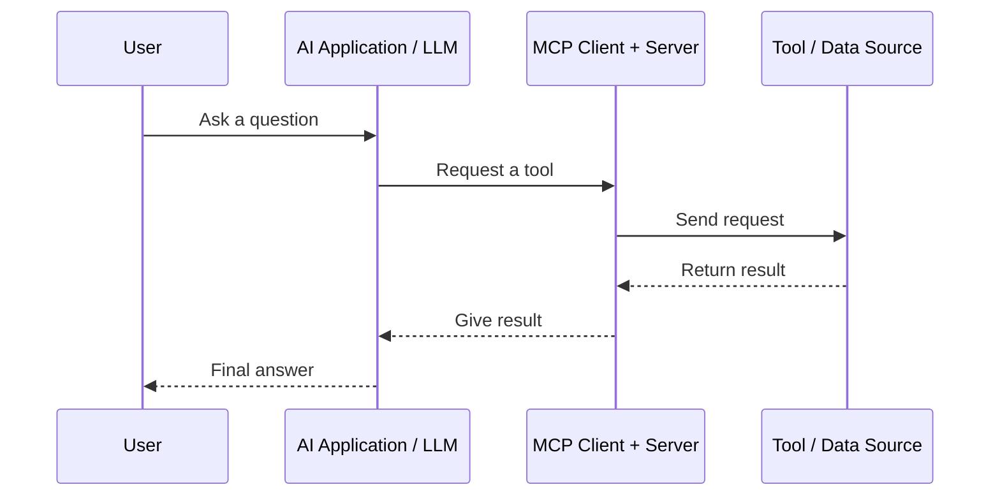

# MCP Communication Flow

> [!abstract] In one line
> The LLM chooses a needed tool; MCP carries the request to that tool and returns the result.

## Steps

1. The **user** asks a question.
2. The **LLM** decides it needs a tool, for example web search.
3. The **MCP client** sends the request to the correct MCP server.
4. The **server** uses its tool or data source.
5. The result comes back through MCP.
6. The **LLM** uses that result in its final answer.

## Discovery

Before making a request, an MCP server can tell the AI application what it offers:

- **Tools** — actions it can perform
- **Resources** — information it can provide
- **Prompts** — reusable prompt templates

> [!important] Remember
> **Ask → choose tool → MCP request → result → answer**

## Navigation

**Previous:** [[02 - MCP Architecture]]  
**Next:** [[04 - MCP Practical Example]]
