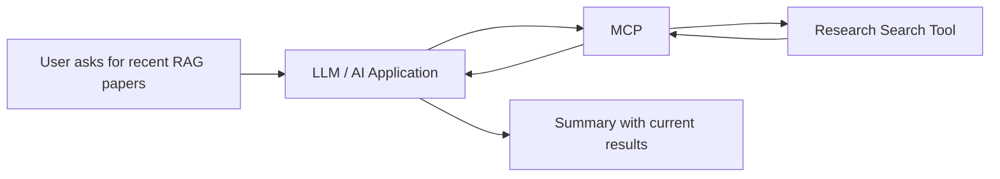

---
title: MCP Practical Example
aliases:
  - MCP Example
tags:
  - AI/MCP
---

# MCP Practical Example

## Question

> “Find recent papers about RAG and summarize them.”

## Without MCP

The LLM only uses its training and the text in the prompt. It may not know the latest papers.

## With MCP

1. The LLM recognizes that it needs recent research.
2. It asks the MCP client to use a research-search tool.
3. The MCP server searches a source such as arXiv.
4. The server returns paper details.
5. The LLM summarizes the returned results for the user.

## Other tool examples

| Need | Possible tool |
| --- | --- |
| Search the web | DuckDuckGo or another search service |
| Read company documents | RAG database / file system |
| Find research papers | arXiv search |
| Look up reference information | Wikipedia or a knowledge base |

> [!important] Remember
> The LLM decides **what it needs**; MCP provides the standard path to the tool.

## Navigation

**Previous:** [[03 - MCP Communication Flow]]  
**Back to start:** [[01 - Model Context Protocol]]
