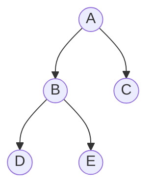

 ---
title: Tree and Terminologies
tags:
  - DSA
  - Data-Structures
  - Trees
---

# Tree and Terminologies

## 1. What is a Tree?

A **Tree** is a non-linear data structure that stores data in a hierarchical form using nodes connected by edges.

Unlike arrays and linked lists, which typically organise elements sequentially, a tree represents parent-child relationships.

### Example

In this tree, `A` is the root node, `B` and `C` are its children, and `D` and `E` are children of `B`.

## 2. Tree Terminologies

### 2.1 Node
A **node** is an individual element of a tree that stores data.

Example: `A`, `B`, `C`, `D` and `E` are nodes.

### 2.2 Root Node
The **root** is the topmost node of a tree. It has no parent.

Example: `A` is the root.

### 2.3 Edge
An **edge** is a connection between two nodes.

Example: `A → B` is an edge.

A tree with `n` nodes has exactly `n - 1` edges.

### 2.4 Parent Node
A **parent** is a node that has one or more child nodes.

Example: `A` is the parent of `B` and `C`.

### 2.5 Child Node
A **child** is a node directly connected below another node.

Example: `B` and `C` are children of `A`.

### 2.6 Sibling Nodes
Nodes that share the same parent are called **siblings**.

Example: `B` and `C` are siblings. Similarly, `D` and `E` are siblings.

### 2.7 Leaf Node
A **leaf node** is a node that has no children. It is also called a terminal node.

Example: `C`, `D` and `E` are leaf nodes.

### 2.8 Internal Node
An **internal node** is a node that has at least one child.

Example: `A` and `B` are internal nodes.

### 2.9 Degree of a Node
The **degree of a node** is the number of its direct children.

Examples:
- Degree of `A` = 2
- Degree of `B` = 2
- Degree of `C` = 0

The degree of a tree is the maximum degree of any node in that tree.

### 2.10 Path
A **path** is a sequence of nodes connected by edges.

Example: `A → B → D` is a path from `A` to `D`.

The path length is the number of edges in the path. Here, the path length is 2.

### 2.11 Ancestor
An **ancestor** of a node is any node on the path from the root to that node, excluding the node itself.

Example: `A` and `B` are ancestors of `D`.

### 2.12 Descendant
A **descendant** of a node is any node that appears below it in the tree.

Example: `D` and `E` are descendants of `B`.

### 2.13 Depth of a Node
The **depth** of a node is the number of edges from the root to that node.

The root has depth 0.

Examples:
- Depth of `A` = 0
- Depth of `B` = 1
- Depth of `D` = 2

### 2.14 Height of a Node
The **height of a node** is the number of edges on the longest downward path from that node to a leaf.

Leaf nodes have height 0.

Examples:
- Height of `D` = 0
- Height of `B` = 1
- Height of `A` = 2

The height of a tree is the height of its root.

### 2.15 Subtree
A **subtree** consists of a node and all its descendants.

Example: the subtree rooted at `B` contains `B`, `D` and `E`.

### 2.16 Forest
A **forest** is a collection of disjoint trees.

If the root of a tree is removed, its remaining subtrees form a forest.

## 3. Important Properties of Trees

1. A tree is a connected, acyclic structure.
2. A tree with `n` nodes has `n - 1` edges.
3. There is exactly one simple path between any two nodes in a tree.
4. Every node except the root has exactly one parent.
5. A tree with one node has height 0 under the edge-count convention used here.

## 4. Tree vs Binary Tree

| Tree | Binary Tree |
|---|---|
| A node may have any number of children. | A node has at most two children. |
| Children are not necessarily limited to left and right. | Children are conventionally called left and right. |
| Used for general hierarchies. | Used in BSTs, heaps and expression trees. |

## 5. Quick Revision

- **Root:** Topmost node.
- **Leaf:** Node with no children.
- **Degree:** Number of children of a node.
- **Depth:** Distance from the root, measured in edges.
- **Height:** Longest downward path to a leaf, measured in edges.
- **Sibling:** Nodes with the same parent.
- **Subtree:** A node and its descendants.
- **Forest:** A collection of disjoint trees.

## Related Notes

- [[02_Binary_Tree]]
- [[Tree Traversals]]
- [[Binary Search Tree]]
- [[AVL Tree]]
- [[Heap Data Structure]]
