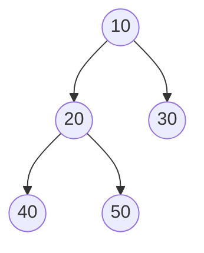

# Binary Tree

## 1. What is a Binary Tree?

A **Binary Tree** is a non-linear hierarchical data structure in which each node can have at most two children:

- Left child
- Right child

A node can have zero, one, or two children.

Binary trees are used in searching, sorting, expression evaluation, and priority queue implementations.

## 2. Structure of a Binary Tree



In this example:
- `10` is the root node.
- `20` is the left child of `10`.
- `30` is the right child of `10`.
- `40` and `50` are children of `20`.
- `30`, `40` and `50` are leaf nodes.

## 3. Representation of a Binary Tree

A binary tree can be represented in two common ways.

### 3.1 Linked Representation

Each node stores three things:
1. Data
2. Pointer to the left child
3. Pointer to the right child

C++ structure:

```cpp
struct Node {
    int data;
    Node* left;
    Node* right;

    Node(int value) {
        data = value;
        left = nullptr;
        right = nullptr;
    }
};
```

Example:

```cpp
Node* root = new Node(10);
root->left = new Node(20);
root->right = new Node(30);
```

### 3.2 Array Representation

In a zero-indexed array representation:

- Root is at index `0`.
- Left child of index `i` is at `2*i + 1`.
- Right child of index `i` is at `2*i + 2`.
- Parent of index `i` (for `i > 0`) is at `(i - 1) / 2`, using integer division.

This representation is especially convenient for complete binary trees and heaps. It may waste space for sparse trees.

## 4. Types of Binary Trees

### 4.1 Full Binary Tree

A **Full Binary Tree** is a tree in which every node has either zero or two children.
![[Pasted image 20261024155028.png]]
### 4.2 Complete Binary Tree

A **Complete Binary Tree** has every level completely filled except possibly the last, and the last level is filled from left to right.

### 4.3 Perfect Binary Tree

A **Perfect Binary Tree** has every internal node with exactly two children, and all leaf nodes are at the same level.

### 4.4 Skewed Binary Tree

A **Skewed Binary Tree** is a tree in which each node has at most one child.

- Left-skewed: nodes extend to the left.
- Right-skewed: nodes extend to the right.

### 4.5 Balanced Binary Tree

A **Balanced Binary Tree** maintains a height that grows logarithmically with the number of nodes, according to the balance condition used by that tree type. AVL trees are one example.

## 5. Important Properties

For a binary tree whose root is at level 0:

1. Maximum number of nodes at level `L` is `2^L`.
2. Maximum number of nodes in a tree of height `h` is `2^(h+1) - 1`.
3. Minimum possible height for `n` nodes is `ceil(log2(n + 1)) - 1`.
4. A binary tree with `n` nodes has `n - 1` edges if `n > 0`.

These maximum-node and minimum-height properties follow from a perfect binary tree.

## 6. Basic C++ Program

```cpp
#include <iostream>
using namespace std;

struct Node {
    int data;
    Node* left;
    Node* right;

    Node(int value) {
        data = value;
        left = nullptr;
        right = nullptr;
    }
};

int main() {
    Node* root = new Node(10);

    root->left = new Node(20);
    root->right = new Node(30);

    root->left->left = new Node(40);
    root->left->right = new Node(50);

    cout << "Root: " << root->data << endl;
    cout << "Left child: " << root->left->data << endl;
    cout << "Right child: " << root->right->data << endl;

    return 0;
}
```

Output:

```text
Root: 10
Left child: 20
Right child: 30
```

## 7. Applications of Binary Trees

- Binary Search Trees for searching and ordered data.
- Heaps for priority queues and heap sort.
- Expression trees for arithmetic expression evaluation.
- Huffman trees for data compression.
- Decision trees for representing choices.

## 8. Quick Revision

- Each node has at most two children.
- A node has separate left and right child pointers.
- Linked representation uses pointers.
- Array representation is efficient for complete trees.
- Full, complete, perfect, skewed and balanced trees have different structural properties.

## Related Notes

- [[01_Tree_Overview]]
- [[Tree Traversals]]
- [[Binary Search Tree]]
- [[AVL Tree]]
- [[Heap Data Structure]]
