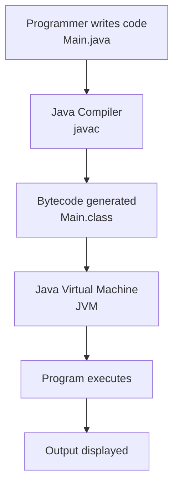
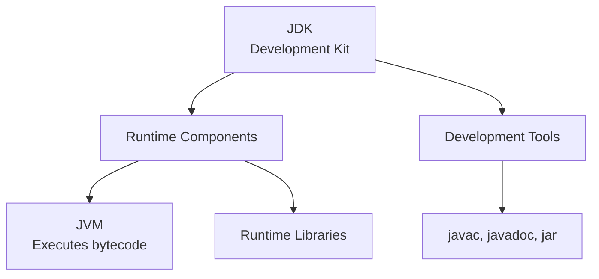
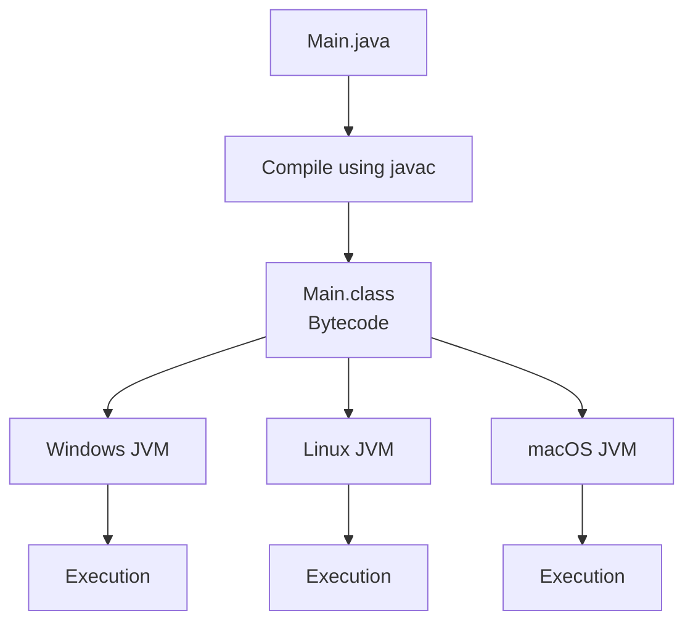
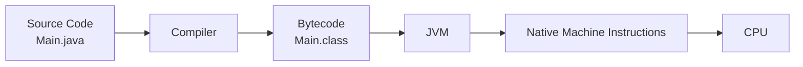
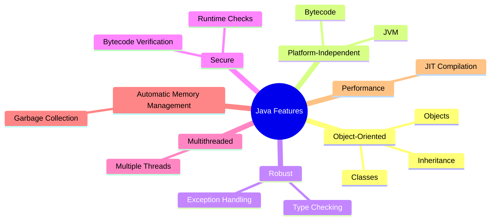
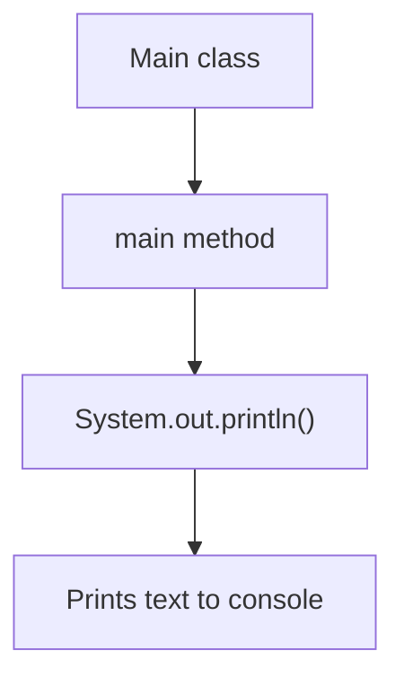
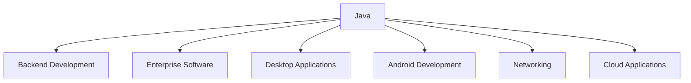

---

# 01 - Java Overview

> [!abstract] Big Picture  
> Java is a programming language used to build applications. We write Java source code, compile it into bytecode, and execute it using the JVM.

## 1. What Is Java?

Java is a **high-level, class-based, general-purpose programming language**.

It is used to build:

- Web applications and backend systems
    
- Desktop applications
    
- Enterprise software
    
- Android applications
    
- Networking applications
    

### Simple Example

```java
public class Main {
    public static void main(String[] args) {
        System.out.println("Hello, Java!");
    }
}
```

**Output:**

```text
Hello, Java!
```

## 2. How Java Works

This is the most important concept in the Java overview.



### Understand It Like This

|Step|What happens?|
|---|---|
|1|We write instructions in a `.java` file.|
|2|`javac` compiles the source code.|
|3|The compiler generates bytecode in a `.class` file.|
|4|The JVM loads and executes the bytecode.|
|5|The program produces its result.|

**Remember:** `javac` compiles Java source code; the JVM executes the resulting bytecode.

## 3. JVM vs JRE vs JDK

Think of Java development as a toolbox with an execution engine.



|Term|Simple meaning|
|---|---|
|JVM|Executes Java bytecode.|
|JRE|Traditional term for the JVM and runtime components needed to run Java applications.|
|JDK|Provides development tools and runtime components for building Java applications.|

> [!tip] Easy Memory Trick  
> **JDK = Develop + Run**  
> **JRE = Run** (traditional packaging concept)  
> **JVM = Execute bytecode**

Modern Java distributions do not always provide a separate JRE download.

## 4. Why Is Java Platform-Independent?

Suppose you write a Java program on Windows and want to run it on Linux.



The same compiled bytecode can run on different operating systems when compatible JVM implementations and required dependencies are available.

This principle is called **Write Once, Run Anywhere (WORA)**.

> [!important] Important Distinction  
> The JVM implementation depends on the platform. Java bytecode is designed to be portable across compatible JVMs.

## 5. Java Source Code vs Bytecode vs Machine Code



|Type|Meaning|
|---|---|
|Source code|Human-readable Java instructions.|
|Bytecode|Instructions designed for execution by a JVM.|
|Machine code|Native instructions that the processor can execute.|

Modern JVMs can interpret bytecode and use a **Just-In-Time (JIT) compiler** to compile frequently executed code into native machine code.

## 6. Important Features of Java



|Feature|Meaning|
|---|---|
|Object-oriented|Organizes programs using classes and objects.|
|Platform-independent|Bytecode can run on compatible JVMs.|
|Robust|Supports type checking and exception handling.|
|Secure|Provides bytecode verification and runtime security mechanisms.|
|Multithreaded|Supports concurrent execution using threads.|
|Automatic memory management|Garbage collection reclaims eligible heap memory.|
|High-performance|JVM optimizations improve execution speed.|

**Note:** Java is not purely object-oriented because it has primitive types such as `int`, `char`, and `boolean`.

## 7. Basic Java Program Structure

```java
public class Main {
    public static void main(String[] args) {
        System.out.println("Hello, Java!");
    }
}
```



|Code|Purpose|
|---|---|
|`class Main`|Declares a class named `Main`.|
|`public`|Makes the declaration accessible according to Java access rules.|
|`static`|Allows the main method to be invoked without creating a `Main` object.|
|`void`|Means the method returns no value.|
|`main`|Conventional entry-point method for launching a Java application.|
|`String[] args`|Receives command-line arguments.|
|`System.out.println()`|Prints text followed by a newline.|

We'll explore every line in [[02 - Java Program Structure]].

## 8. Compile and Run a Java Program

### Step 1 — Create `Main.java`

```java
public class Main {
    public static void main(String[] args) {
        System.out.println("Hello, Java!");
    }
}
```

### Step 2 — Compile

```bash
javac Main.java
```

This generates `Main.class` if compilation succeeds.

### Step 3 — Run

```bash
java Main
```

**Output:**

```text
Hello, Java!
```

Check your installation with:

```bash
java -version
javac -version
```

## 9. Where Is Java Used?



## 10. Advantages and Limitations

|Advantages|Limitations|
|---|---|
|Large ecosystem and libraries|Can use more memory than some alternatives|
|Automatic garbage collection|Garbage collection can introduce pauses|
|Strong type checking|More verbose than some languages|
|Built-in concurrency support|Concurrent programming can be complex|
|Portable bytecode|Platform-specific dependencies can reduce portability|

## 11. Quick Revision

- Java is a high-level, class-based programming language.
    
- `javac` converts Java source code into bytecode.
    
- `.java` is the source file extension.
    
- `.class` files contain Java bytecode.
    
- The JVM loads, verifies, and executes bytecode.
    
- The JDK provides tools for developing Java applications.
    
- Java platform independence is based on portable bytecode and compatible JVMs.
    
- The JIT compiler can convert frequently executed bytecode into native machine code.
    
- Garbage collection automatically reclaims eligible heap memory.
    

## Related Notes

- [[Java Programming - Home]]
    
- [[02 - Java Program Structure]]
    
- [[Java Compilation Process]]
    
- [[Java Virtual Machine (JVM)]]
    
- [[Java Development Kit (JDK)]]
    
- [[Java Runtime Environment (JRE)]]
    
- [[Java Features]]
    
- [[Java Platform Independence]]```text
```button
name Next →
type link
action 02 - Java Program Structure
