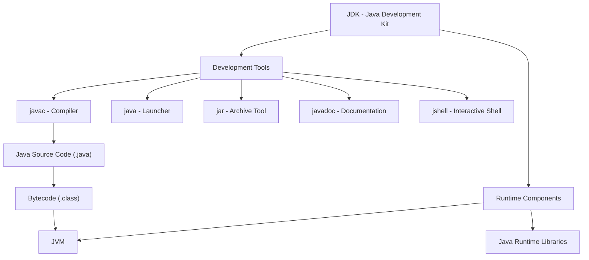

# 02 - Java Development Kit (JDK)

> [!abstract] Big Picture  
> The **Java Development Kit (JDK)** provides the tools and runtime components required to develop, compile, and run Java programs.

## 1. What Is JDK?

Imagine you're building a house. You need tools to construct it.

Similarly, when developing Java applications, you need tools to compile your source code and run your program. The JDK provides these tools.

**JDK = Development Tools + Runtime Components**

## 2. JDK Architecture

## 2. JDK Architecture




**Understand the diagram:**

- **Development tools:** Help you compile, package, inspect, and document Java applications.
    
- **Runtime components:** Provide the environment and libraries needed to execute applications.
    
- **JVM:** Loads, verifies, and executes Java bytecode.
    

The exact runtime packaging can vary between JDK distributions and versions.

## 3. Important JDK Tools

|Tool|Purpose|Example|
|---|---|---|
|`javac`|Compiles Java source code|`javac Main.java`|
|`java`|Launches Java applications|`java Main`|
|`jar`|Creates and manages JAR archives|`jar --create --file app.jar Main.class`|
|`javadoc`|Generates API documentation|`javadoc Main.java`|
|`jshell`|Executes Java statements interactively|`jshell`|
|`javap`|Examines compiled class files|`javap Main`|

## 4. How JDK Works

Let's understand the complete process using a simple program.

### Step 1: Write the source code

Create a file named `Main.java`.

```
public class Main {
    public static void main(String[] args) {
        System.out.println("Hello, Java!");
    }
}
```

### Step 2: Compile the source code

Run this command in your terminal:

```
javac Main.java
```

The compiler checks your source code and generates `Main.class` if compilation succeeds.

```
flowchart LR
    A["Main.java"] --> B["javac"]
    B --> C["Main.class"]
```

### Step 3: Run the program

Execute:

```
java Main
```

Output:

```
Hello, Java!
```

```
flowchart TD
    A["Main.class"] --> B["java launcher"]
    B --> C["JVM"]
    C --> D["Execute bytecode"]
    D --> E["Display output"]
```

> [!important] Remember  
> `javac` compiles the code, `java` launches the application, and the JVM executes the bytecode.

## 5. JDK vs JRE vs JVM

```
flowchart TD
    A["JDK"] --> B["Development Tools"]
    A --> C["Runtime Components"]
    C --> D["JVM"]
    C --> E["Runtime Libraries"]
```

| Component | Main responsibility                                                   |
| --------- | --------------------------------------------------------------------- |
| JDK       | Provides tools for Java development and runtime components.           |
| JRE       | Traditional term for the environment needed to run Java applications. |
| JVM       | Executes Java bytecode.                                               |

**Easy way to remember:**

- **JDK:** Develop and run.
    
- **JRE:** Runtime environment.
    
- **JVM:** Bytecode execution engine.
    

Modern Java distributions do not always provide a separate JRE installation.

## 6. What Is PATH?

`PATH` is an operating-system environment variable containing directories searched when you run a command.

For example, when you type `javac`, the operating system searches the configured locations to find the compiler executable.

```
flowchart TD
    A["Open terminal"] --> B["Type javac"]
    B --> C["Operating system searches PATH"]
    C --> D["Find JDK bin directory"]
    D --> E["Run compiler"]
```

If the JDK is installed but its `bin` directory is not discoverable through `PATH`, the command might not work from your terminal.

## 7. Check JDK Installation

On Windows, open Command Prompt or PowerShell.

Check the Java launcher:

```
java -version
```

Check the Java compiler:

```
javac -version
```

If both commands display version information, the launcher and compiler are available through your current environment.

If `java` works but `javac` does not, check whether a JDK is installed and whether its `bin` directory is configured correctly.

## 8. Install a JDK

Download a suitable JDK from a trusted distributor:

- [Oracle Java Downloads](https://www.oracle.com/java/technologies/downloads/)
    
- [Eclipse Temurin](https://adoptium.net/)
    

After installation, reopen your terminal and run:

```
java -version
javac -version
```

You can then create, compile, and run your first Java program.

## 9. Advantages of JDK

- Provides the compiler and other development tools.
    
- Includes runtime components and standard Java libraries.
    
- Supports application packaging and documentation generation.
    
- Helps developers build applications for different environments.
    
- Provides tools for inspecting compiled Java classes.
    

## 10. Common Mistakes

| Mistake                                             | Correct approach                                               |
| --------------------------------------------------- | -------------------------------------------------------------- |
| Assuming JDK and JVM are the same                   | The JDK provides development tools; the JVM executes bytecode. |
| Using `java Main.class`                             | For a compiled class, normally use `java Main`.                |
| Assuming `java` and `javac` are interchangeable     | `java` launches applications; `javac` compiles source code.    |
| Assuming every installation includes a separate JRE | Modern JDK distributions vary in runtime packaging.            |
| Forgetting to check `PATH`                          | Verify both `java -version` and `javac -version`.              |

## 11. Quick Revision

- JDK stands for Java Development Kit.
    
- `javac` compiles `.java` source files into `.class` bytecode.
    
- `java` launches Java applications.
    
- JVM executes Java bytecode.
    
- `jar` manages Java archive files.
    
- `javadoc` generates documentation.
    
- `jshell` provides an interactive Java shell.
    
- `PATH` helps the operating system locate executable commands.
    

## Navigation

```button
name ← Previous: Java Overview
type link
action 01 - Java Overview
```

```button
name Next → JVM
type link
action 03-JVM

```